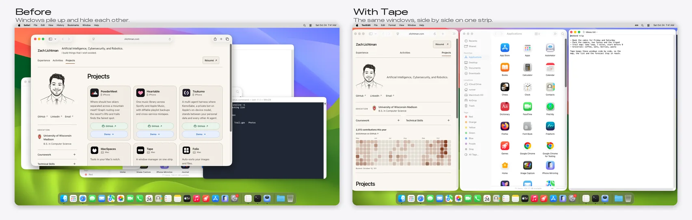
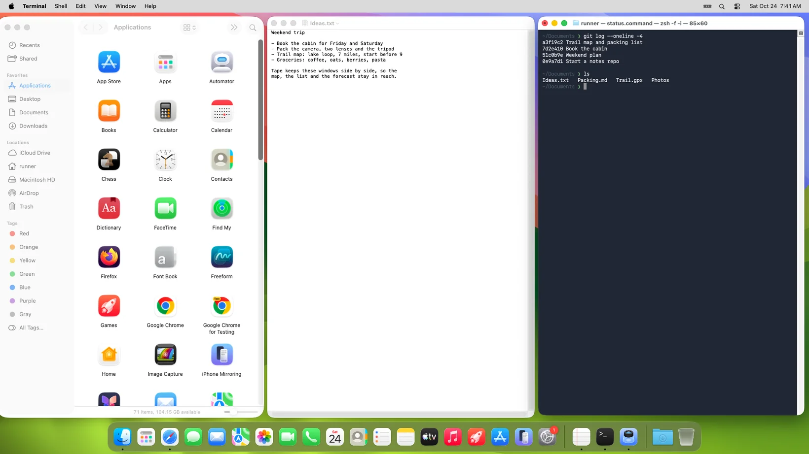
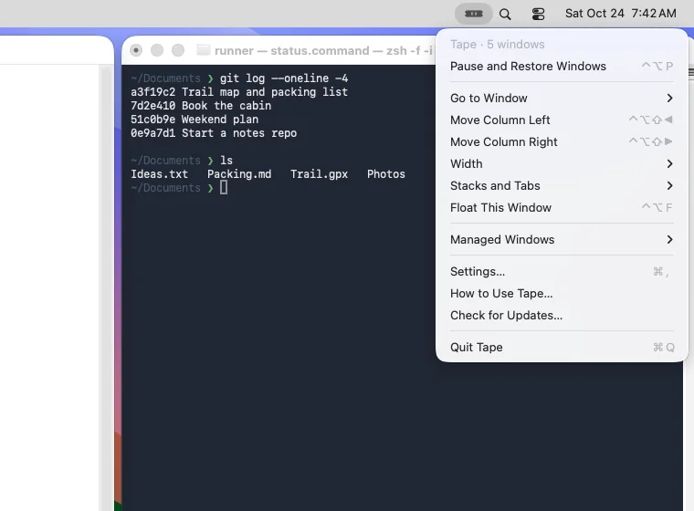
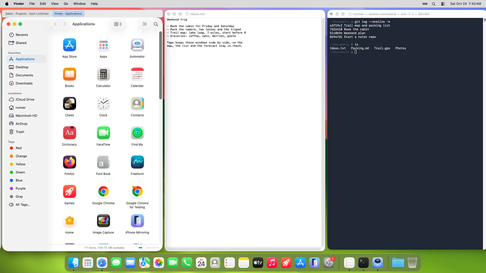
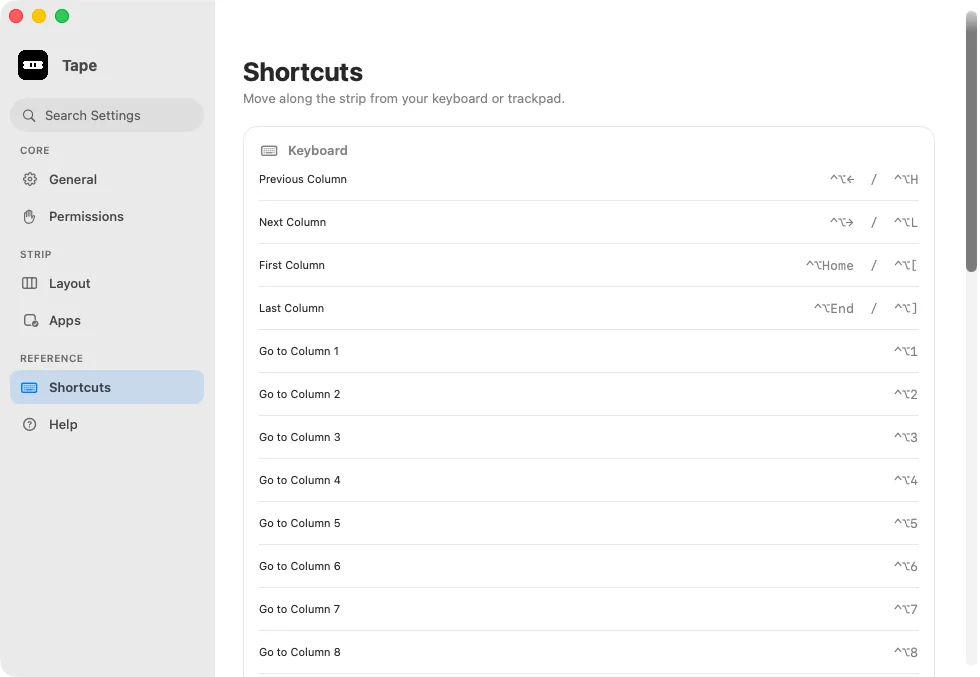

# Tape

**A window manager on one strip.**

macOS 13+ · Apple Silicon + Intel · MIT License

[Website](https://www.zlichtman.com/tape) · [Download](https://github.com/zlichtman/Tape/releases/latest/download/Tape.dmg) · [Report Issue](https://github.com/zlichtman/Tape/issues)



Tape arranges windows side by side on a horizontal strip. Move focus to bring the
next column into view, or hold Control–Option and scroll horizontally with two
fingers to browse without switching apps.

## Status

Tape includes independent display strips, keyboard navigation, column reordering,
width presets, floating windows, animation, Accessibility onboarding, and Pause.
Native Settings include section search, app selection, and a verified self-updater. Settings changes apply immediately.

## Requirements

- macOS 13 or later.
- Accessibility access to move, resize, and focus windows.
- For building: Xcode 26 or later (Icon Composer support), and XcodeGen.

## Install

```sh
brew install --cask zlichtman/tap/tape
open -a Tape
```

Follow the first-run guide, allow Accessibility access in System Settings →
Privacy & Security → Accessibility, then choose **Start Tape**. The notarized
installer is also available on the GitHub Releases page.

Use Control-Option with the left/right arrows to focus columns, Shift plus those
keys to reorder them, W to cycle widths, F to float a window, and P to pause or
resume. Control–Option–1 through 9 jumps to a column; Home/End with the same
modifiers jumps to either end. On a compact keyboard, use Control–Option–[ / ]. Hold Control–Option before starting a horizontal
two-finger scroll to browse the strip. It follows your natural-scroll preference
and macOS momentum without changing the active app; click a window or use a
focus shortcut to select it. Ordinary scrolling remains with your apps. Keyboard navigation follows the display
with the selected window; browsing another display does not change it.
Control–Option–D moves the selected window to the next enabled display.



Choose **Settings** from the Tape menu to change spacing and managed apps or search
for a setting. Pause or Quit restores managed windows.

You can also use **Go to Window**, **Width**, and **Managed Windows → Choose Apps**
from the native menu. In Settings → Apps, uncheck apps Tape should leave alone,
or choose **Only selected apps** to opt apps in individually.



Release builds use Developer ID signing and notarization. Locally built Debug
builds are ad-hoc signed; only published installers have completed notarization.
Use a stable Applications path when granting access; rebuilds may require you to
remove and add Tape again in Accessibility settings.

## Features

- One independent strip per enabled display; mirrored displays share a strip.
- Focus left/right, first/last, or column 1–9.
- Control–Option horizontal precision scrolling on the display under the pointer, with momentum and no app activation.
- Move a selected window to another display from the menu or Control–Option–D; retain its width preset.
- Enable/disable each display in General settings. Disabled displays are left alone.
- Display-paced motion and independent write queues per app.
- Move columns without changing their widths.
- A lone automatic-width window fills the screen; app tabs keep its layout. Explicit widths remain yours.
- Width presets: ⅓ → ½ → ⅔ → Full; finer width adjustments and Make All Columns This Width.
- Native edge resizing, optional Resize Columns Together, and title-bar drag reordering with edge browsing.
- Stacks and tabs, native tab selection and drag reordering, adjustable/equal stack heights, and separation back into columns.
- Manage only checked open windows; unchecking restores each window and leaves it alone.
- Float or tile the focused window.
- Dialogs, fixed-size panels, attached sheets, and full-screen windows stay outside the strip.
- Window and edge gaps, centring modes, and reduced-motion support.
- Search Settings by section, with arrows, Return, Escape, and Command-F.
- Native macOS menu and system appearance.
- Choose which apps Tape manages; deselecting an app restores its windows.
- Verified updates with confirmation before relaunching.
- Background windows join without activating their app or scrolling the strip.
- Pause and Quit restore original frames within the current display's usable bounds.

Choose **Managed Windows → Only Checked Windows** in the menu, or use Settings → Apps, to limit Tape to the focused window and check any others to include. These choices follow currently open native windows through Pause/Resume and temporary hiding or minimization; they reset when Tape quits. New windows stay outside Tape while this is on. App selection remains a separate persistent setting.



Join the focused window into the column on its left/right with Control–Option–, / .; separate it with Control–Option–Shift–,. Control–Option–T switches a group between stacked windows and tabs. Control–Option–Up/Down selects a window in a group; adding Shift reorders it. Drag a Tape tab to another tab’s position. Stack height controls and Equal Stack Heights are in **Stacks and Tabs** in the menu.

The **Shortcuts** page in Settings lists all implemented bindings. Focus also has
H/L alternatives. Bindings use physical key positions; recording custom bindings
is planned for a later build.



At an outer display edge, overflow windows retain a small visible sliver. At an
edge shared with another display, they park inside the managed display, behind
the focused window. This avoids moving them onto the neighboring display.

## Permissions

Tape asks only for Accessibility. It uses public window metadata to identify
on-screen windows and does not capture the screen. Logs contain lifecycle events
and errors, never window titles. There is no account or telemetry.

For predictable layouts, turn off Stage Manager and automatic window tiling, and
pause other window-arranging tools. The automated Mac Setup check is planned for a
later release.

## Uninstall

Quit Tape to restore its managed windows, run `brew uninstall --cask tape`, and
remove its entry in System Settings → Privacy & Security → Accessibility.
Optionally remove `~/Library/Application Support/Tape` and the preferences domain
`dev.opensource.Tape`.

## Build From Source

```sh
make test
make build
open /tmp/Tape-build/Build/Products/Debug/Tape.app
```

`project.yml` is canonical; the generated Xcode project is ignored. The build
contains both arm64 and x86_64 with a macOS 13 deployment target. Build output goes
to `/tmp` so iCloud file metadata cannot interfere with code signing. Override
`BUILD_DIR` or `TEST_DIR` if needed.

The artwork and generated app icon assets are included. To regenerate assets:

```sh
swift Scripts/generate-icons.swift
```

## Development

`Sources/Engine` contains the pure strip model, layout functions, window
classification, and the window-server protocol. `swift test` covers layout,
parking and restoration geometry, foreground/background insertion, focus,
reordering, and width presets.

`Sources/Platform` contains Accessibility observers, the worker and its deadline,
coalesced frame writes, refresh-synchronized animation, Carbon hot keys, and a
small rolling log. No recurring idle timer is used. Window calls have a 50 ms
messaging timeout; an 8-second operation deadline restarts the worker and pauses
Tape. A timed-out remote app may need to recover before its frame can be restored.

`Sources/App` contains the menu bar app, controller, Settings and first-run guide.
The app offers an isolated `--ui-preview` mode for reviewing Settings without
starting the engine or registering global shortcuts.

Later milestones add persisted desktop restoration,
optional gestures, custom shortcut recording, rules UI, and integrations. No private Spaces or gesture APIs are included in this
build. Hardware acceptance checks are listed in `CHECKS.md`.

## Release

```sh
make release
./Scripts/prepare-homebrew.sh
```

The default notarization keychain profile is the owner-authorized `MacSpaces`
profile, shared with the existing release setup. Specify another authorized
profile with `TAPE_NOTARY_PROFILE`. The script checks profile access before
building or signing; run packaging in a session that can access that Keychain
profile and Apple’s timestamp and notarization services. The release script signs
with team `28LJG7MXT3`, notarizes and staples the app and DMG separately, then verifies
the mounted app and Gatekeeper acceptance. `TAPE_NOTARIZE=0` creates a local
signed installer for review; it is not publishable.

The updater reads `zlichtman/Tape`'s latest release, expects `Tape.dmg`, and
validates bundle ID, team, version, build, minimum macOS, and architecture.
Published release descriptions contain exactly one `<!-- tape-build:N -->` marker.
Versions follow MacSpaces: `1.28` is build `28`; a following release `1.29` uses
build `29`. Settings displays only the public version. CI retains an unsigned universal app artifact from its exact source commit. When local Icon Composer export is unavailable, download that successful run’s artifact and set `TAPE_PREBUILT_APP` for the existing release script. Identity, version, build, source revision, architectures, signing and notarization gates still apply.

Published installers also embed their
source commit; the publisher rejects an installer built from a different commit.

## Credits

The settings conventions and updater were adapted from this
project owner's existing Swift applications. No third-party window-manager
code or artwork is included.
