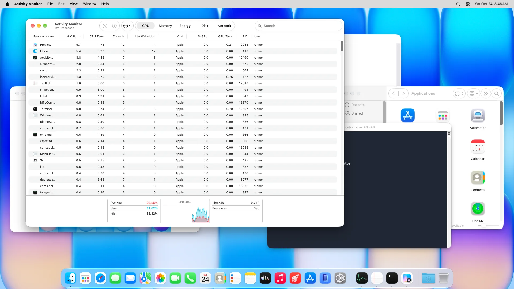
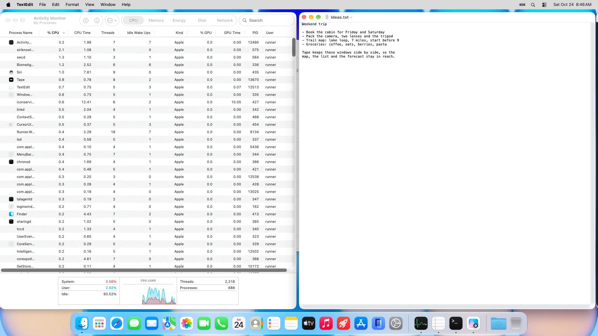

# Tape

**A window manager on one strip.**

macOS 13+ · Apple Silicon + Intel · MIT License

[Website](https://www.zlichtman.com/tape) · [Download](https://github.com/zlichtman/Tape/releases/latest/download/Tape.dmg) · [Report Issue](https://github.com/zlichtman/Tape/issues)

Tape arranges windows side by side on a horizontal strip. Move focus to bring the
next column into view, or hold Control–Option and scroll horizontally with two
fingers to browse without switching apps.

**Before:** windows pile up and hide each other.



**With Tape:** the same windows, side by side on one strip.



## Requirements

- macOS 13 or later, on Apple silicon or Intel.
- Accessibility access, so Tape can move, resize and focus windows.

## Install

```sh
brew install --cask zlichtman/tap/tape
open -a Tape
```

Or download [Tape.dmg](https://github.com/zlichtman/Tape/releases/latest/download/Tape.dmg),
a notarized installer, and drag Tape into Applications. Follow the first-run guide,
allow Accessibility access in System Settings → Privacy & Security → Accessibility,
then choose **Start Tape**. Tape lives in the menu bar; opening it again shows Settings.

## Using Tape

Use Control–Option with the left/right arrows to focus columns, add Shift to reorder
them, W to cycle widths, F to float a window, and P to turn Tape off or on.
Control–Option–1 through 9 jumps to a column; Home/End (or [ / ]) jump to either end.
Control–Option–D moves the selected window to the next display.

Hold Control–Option before starting a horizontal two-finger scroll to browse the
strip under the pointer. It follows your natural-scroll setting and momentum without
switching apps; click a window or use a focus shortcut to select it. Ordinary
scrolling stays with your apps.


Everything is also in the Tape menu, with its shortcut beside each command. Turning
Tape off, or quitting, puts your windows back where they were.


## Features

- One strip per display; mirrored displays share one.
- Width presets ⅓ → ½ → ⅔ → Full, finer adjustments, and Make All Columns This Width.
  A lone window fills the screen.
- Drag a title bar to reorder columns, or drag a window's edge to resize it. Resize
  Columns Together applies a width change to the whole strip.
- Stacks and tabs: join neighboring columns, switch between a stack and tabs, and
  separate a window again.
- Float a window to move it freely, or manage only the windows you check.
- Choose which apps Tape manages. Dialogs, sheets, fixed-size panels and full-screen
  windows stay outside the strip.
- Hidden, minimized and other-desktop windows return to their own place.
- Window and edge gaps, centering, and instant moves for reduced motion.
- Searchable Settings and verified updates that ask before relaunching.


Join the focused window into the column on its left or right with Control–Option–,
or .; separate it with Control–Option–Shift–,. Control–Option–T switches between
a stack and tabs, and Control–Option–Up/Down selects a window in the column.


At a display's outer edge, columns beyond the screen keep a small visible sliver. At
an edge shared with another display, they wait behind the focused window instead.

## Permissions

Tape asks only for Accessibility. It uses public window information to find
windows and never captures the screen. The log records events and errors, never
window titles. There is no account and no telemetry.

For predictable layouts, turn off Stage Manager and automatic window tiling, and
pause other window managers.

## Uninstall

Quit Tape to put its windows back, run `brew uninstall --cask tape`, and remove its
entry in System Settings → Privacy & Security → Accessibility. Optionally remove
`~/Library/Application Support/Tape` and the preferences domain `dev.opensource.Tape`.

## Build From Source

Requires Xcode 26 or later and XcodeGen.

```sh
make test
make build
open /tmp/Tape-build/Build/Products/Debug/Tape.app
```

`project.yml` is canonical; the generated Xcode project is ignored. Builds are
universal and go to `/tmp`. Local builds are ad-hoc signed, so after rebuilding you
may need to remove and re-add Tape in Accessibility settings. `Sources/Engine` holds
the strip model and layout, `Sources/Platform` the Accessibility and input layer, and
`Sources/App` the menu bar app and Settings.
